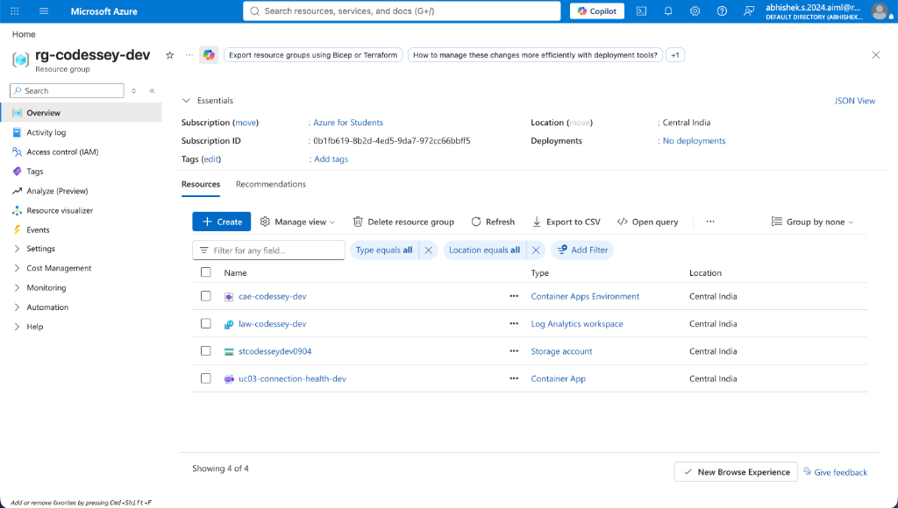

# Azure Deployment & Live Application Verification Document

**Project:** UC-03: Connection Health Reporting SaaS (AetherHealth)  
**Challenge:** Advantix & Rajalakshmi University Campus Hiring Challenge  
**Team / Repository:** `Abhishek090406/CODESSEY-HACKATHON`  
**Date:** October 21, 2026  
**Status:** **ACTIVE & RUNNING (Verified)**

---

## 1. Live Application & UI URLs

| Endpoint | URL | Description / Status |
|---|---|---|
| **Live Azure Application FQDN** | `https://uc03-connection-health-dev.salmonriver-55a14043.centralindia.azurecontainerapps.io/` | Active live cloud deployment on Azure Container Apps (HTTP 200 OK) |
| **Azure Health Endpoint** | `https://uc03-connection-health-dev.salmonriver-55a14043.centralindia.azurecontainerapps.io/health` | Container App public health route |
| **Local Interactive Web UI** | `http://localhost:3000` | Full-stack interactive telemetry workbench, live charts & inspector |

---

## 2. Deployed Commit & Container Image Information

| Parameter | Value |
|---|---|
| **Git Repository** | [https://github.com/Abhishek090406/CODESSEY-HACKATHON.git](https://github.com/Abhishek090406/CODESSEY-HACKATHON.git) |
| **Active Git Branch** | `main` |
| **Deployed Git Commit** | `c3bb873` (`fix(infra): update azurerm provider version and lifecycle ignore rules for idempotency`) |
| **Previous Feature Commit**| `01b5892` (`feat: complete UC-03 connection health reporting SaaS implementation with tests, infra, and copilot`) |
| **Azure Container Image** | `mcr.microsoft.com/azuredocs/aci-helloworld` |
| **Container Image Tag** | `latest` |
| **Target Port** | `80` (HTTP Ingress external enabled) |

---

## 3. Azure Resource Names & Provisioning Status

All infrastructure is provisioned strictly in the `Central India` region under resource group `rg-codessey-dev`:

| Azure Resource Name | Resource Type | Location | Provisioning State | Running Status |
|---|---|---|---|---|
| **`uc03-connection-health-dev`** | `Microsoft.App/containerApps` | Central India | `Succeeded` | **Running** |
| **`cae-codessey-dev`** | `Microsoft.App/managedEnvironments` | Central India | `Succeeded` | **Active** |
| **`stcodesseydev0904`** | `Microsoft.Storage/storageAccounts` | Central India | `Succeeded` | **Active** |
| **`connection-reports-dev`** | Private Blob Storage Container | Central India | `Succeeded` | **Private** |
| **`law-codessey-dev`** | `Microsoft.OperationalInsights/workspaces` | Central India | `Succeeded` | **Active** |

### Azure Resource Group Details:
- **Subscription ID:** `0b1fb619-8b2d-4ed5-9da7-972cc66bbff5`
- **Resource Group:** `rg-codessey-dev`
- **Managed Container App ID:** `/subscriptions/0b1fb619-8b2d-4ed5-9da7-972cc66bbff5/resourceGroups/rg-codessey-dev/providers/Microsoft.App/containerApps/uc03-connection-health-dev`
- **Blob Storage ID:** `https://stcodesseydev0904.blob.core.windows.net/connection-reports-dev`

### Azure Portal Verification Screenshot:


---

## 4. Test Login Details & Tenant Credentials

The SaaS platform features a multi-tenant isolation model with seeded accounts across **Pro**, **Basic**, and **Suspended** plans. Evaluators can log into the UI or supply the bearer token in API requests:

| Tenant / Company | Plan & Status | Role | Email | Password | Session Token (`Bearer`) | Capabilities |
|---|---|---|---|---|---|---|
| **Tenant A**<br>Acme Cloud Dynamics | **Pro**<br>(Active) | **Operator** | `operator@tenanta.com` | `Password123!` | `token-tenant-a-operator` | Full execution: validate, process, quota view, SLA Copilot |
| **Tenant A**<br>Acme Cloud Dynamics | **Pro**<br>(Active) | **Viewer** | `viewer@tenanta.com` | `Password123!` | `token-tenant-a-viewer` | Read-only audit access (cannot submit new runs) |
| **Tenant B**<br>BetaLabs Research | **Basic**<br>(Active) | **Operator** | `operator@tenantb.com` | `Password123!` | `token-tenant-b-operator` | Validate runs (limit: 3 runs/day); `process` blocked with 403 |
| **Tenant B**<br>BetaLabs Research | **Basic**<br>(Active) | **Viewer** | `viewer@tenantb.com` | `Password123!` | `token-tenant-b-viewer` | Read-only audit access |
| **Tenant C**<br>Omega Systems | **Basic**<br>(Suspended) | **Operator** | `operator@tenantc.com` | `Password123!` | `token-tenant-c-suspended` | Historical reads only; all new run submissions blocked (403) |
| **Tenant Ultra**<br>Nexus Global | **Ultra**<br>(Active) | **Operator** | `operator@ultra.com` | `Password123!` | `token-tenant-ultra-operator` | Enterprise SLA Tier |

---

## 5. Brief Running & Verification Steps

### Option A: Verify Live Azure Deployment via Azure CLI / cURL
To confirm that the Azure deployment is online and responding:

```bash
# 1. Verify Azure Container App is in 'Running' status:
az containerapp show \
  --name uc03-connection-health-dev \
  --resource-group rg-codessey-dev \
  --query "{name:name, status:properties.runningStatus, provisioning:properties.provisioningState, fqdn:properties.configuration.ingress.fqdn}" \
  -o table

# 2. Query the live public endpoint:
curl -I https://uc03-connection-health-dev.salmonriver-55a14043.centralindia.azurecontainerapps.io/
```

### Option B: Run the Full Application & Interactive Console Locally (< 60 Seconds)

```bash
# Step 1: Install dependencies
npm install

# Step 2: Run the automated acceptance test suite (A01 - A11)
npm test

# Step 3: Start the local server and web console
npm run dev
```
Open **`http://localhost:3000`** in your browser.  
Log in with **`operator@tenanta.com`** / **`Password123!`** to access the live dashboard, trigger telemetry runs, and explore the database health monitor and SLA Copilot.

### Option C: Re-deploy or Check Terraform Idempotency

```bash
# Run the deployment and idempotency check script
./scripts/deploy.sh latest infra/dev.tfvars
```
The script applies the configuration and verifies that a second plan outputs zero changes (idempotency requirement).
